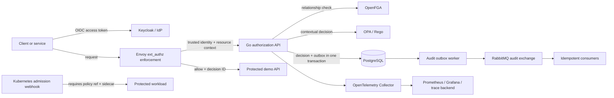

# Go Authorization Platform

[](https://github.com/mmmihaeel/go-authorization-platform/actions/workflows/ci.yml)
[](https://github.com/mmmihaeel/go-authorization-platform/actions/workflows/security.yml)
[](https://go.dev/)
[](LICENSE)

A production-style **authorization control plane in Go** that composes:

- **OpenFGA** for durable RBAC/ReBAC relationships and Zanzibar-style permission inheritance;
- **OPA/Rego** for contextual ABAC constraints and the final allow/deny decision;
- **Keycloak/OIDC** boundaries for identity, workload principals, token exchange, and delegation;
- **Envoy `ext_authz`** for fail-closed sidecar/gateway enforcement;
- **PostgreSQL transactional outbox + RabbitMQ** contracts for auditable, idempotent decision events;
- **Kubernetes, Helm, Argo CD, Terraform/Terragrunt, OpenTelemetry, Prometheus, and Grafana** deployment evidence.

The domain is intentionally neutral: a multi-tenant document collaboration platform with organizations, teams, folders, documents, users, and service principals. This keeps the repository focused on authorization engineering rather than pretending to reproduce a bank's proprietary domain.

> **Portfolio integrity:** this repository is a public engineering project, not a claim that the author operated this exact platform in production. Implemented code, integration-ready adapters, and roadmap items are explicitly separated below.

## Why this repository exists

Most authorization demos stop at a role table or a handful of endpoints. This project is designed to show the engineering work around the decision itself:

- model ownership and versioning;
- tenant isolation and confused-deputy prevention;
- relationship and contextual policy composition;
- sidecar enforcement and failure-mode behavior;
- immutable decision evidence and event delivery;
- concurrency, race safety, policy tests, benchmarks, deployment controls, and incident response.

## Architecture



The API uses **deny by default**. OpenFGA answers *whether a relationship path permits the operation*; OPA then evaluates tenant equality, account state, risk, MFA, trusted-device, classification, and purpose constraints. Neither engine silently overrides the other.

See [Architecture](docs/architecture.md), [Authorization model](docs/authorization-model.md), and [ADR 0001](docs/adr/0001-openfga-plus-opa.md).

## Current implementation status

### Implemented in the starter

- Go decision service with validation, normalization, reason codes, correlation IDs, and fail-closed dependency errors;
- self-contained demo checker/policy plus HTTP clients for real OpenFGA and OPA services;
- `POST /v1/decisions/check` and an Envoy-compatible `/v1/ext-authz/*` endpoint;
- multi-tenant OpenFGA model, tuples, and model-test scenarios;
- Rego v1 policy and positive/negative policy tests;
- in-memory audit recorder and a PostgreSQL transaction that stores a decision and its outbox event atomically;
- bounded-concurrency outbox worker, stale publishing-lease recovery, and an idempotent consumer contract;
- optional build-tag adapters for Keycloak OIDC, pgx, RabbitMQ, and OpenTelemetry;
- Prometheus-format decision metrics;
- Kubernetes `AuthorizationPolicyBinding` CRD and a tested validating admission webhook;
- Docker Compose profiles, Helm chart, Argo CD application, Terraform/Terragrunt module, dashboards, alerts, and runbooks;
- unit, integration, HTTP contract, race, and benchmark tests.

### Executable verification completed for this starter

- strict formatting and `go vet`;
- all default-path unit and integration tests;
- `go test -race ./...`;
- builds for all four commands;
- allow/deny HTTP smoke flow, metrics output, and malformed/trailing JSON cases;
- an in-process benchmark for regression comparison only.

The checked-in module and container target Go 1.26. External policy engines and deployment tools were not available in the assembly environment, so the first repository run must execute the version-pinned OPA/OpenFGA, Compose, Helm, Terraform, and optional-adapter checks described in [Starter validation](docs/starter-validation.md). This boundary is recorded explicitly rather than presenting unexecuted configuration as verified evidence.

### Integration-ready, but not wired into the default demo binary

- PostgreSQL audit repository (`-tags postgres`);
- RabbitMQ publisher (`-tags rabbitmq`);
- OIDC verifier (`-tags oidc`);
- OTLP tracing middleware (`-tags otel`);
- Keycloak token-exchange configuration beyond the local realm baseline;
- remote OpenFGA store IDs, which are generated during bootstrap.

This separation keeps `make run` fast and deterministic while preserving production-oriented adapters for the next implementation phase.

### Deliberately left for the roadmap

- a controller that reconciles `AuthorizationPolicyBinding` resources;
- managed-cloud modules and real secret-manager integration;
- a persistent trace backend;
- signed policy bundles and promotion attestations;
- published load-test numbers from repeatable hardware;
- multi-region consistency and disaster-recovery drills.

See [Roadmap](docs/roadmap.md) for acceptance criteria rather than vague feature names.

## Quick start

### 1. Run the executable vertical slice

Requires Go 1.26+.

```bash
go mod tidy
make check
make run
```

In another terminal:

```bash
make smoke
```

Example allow request:

```bash
curl --fail-with-body http://localhost:8080/v1/decisions/check \
  -H 'Content-Type: application/json' \
  -H 'X-Request-ID: readme-example' \
  --data '{
    "subject": {
      "id": "alice",
      "tenant_id": "acme",
      "roles": ["tenant_admin"]
    },
    "resource": {
      "type": "document",
      "id": "roadmap",
      "tenant_id": "acme",
      "attributes": {"classification": "internal"}
    },
    "action": "view",
    "context": {
      "device_trusted": true,
      "mfa": true,
      "risk_score": 10,
      "purpose": "project_delivery"
    }
  }'
```

Response shape:

```json
{
  "decision_id": "c7746e8f-...",
  "correlation_id": "readme-example",
  "allowed": true,
  "reason_codes": ["allowed"],
  "evaluated_at": "2026-08-12T12:00:00Z",
  "latency_ms": {"openfga": 0.01, "opa": 0.01, "total": 0.04},
  "audit_recorded": true
}
```

### 2. Demonstrate Envoy fail-closed enforcement

```bash
make sidecar-up
make sidecar-smoke
```

Envoy listens on `localhost:10000`, calls the Go `/v1/ext-authz/*` contract, and only forwards an allowed request to the demo resource API. The authorization decision ID is propagated upstream.

The demo accepts identity headers so the flow is easy to inspect. In a real edge path those headers must be stripped from external traffic and re-created only by a trusted JWT-validation layer; see the [threat model](docs/threat-model.md).

### 3. Start policy infrastructure

```bash
make infra-up
make policy-test
make model-test
./scripts/bootstrap-openfga.sh
```

`bootstrap-openfga.sh` writes generated IDs to `.env.runtime`. Then run the API against real engines:

```bash
set -a
. ./.env.runtime
set +a
go run ./cmd/authz-api
```

### 4. Start identity and observability profiles

```bash
make identity-up
make observability-up
```

- Keycloak: `http://localhost:8082`
- Prometheus: `http://localhost:9090`
- Grafana: `http://localhost:3001`
- OpenFGA playground: `http://localhost:3000`
- RabbitMQ management: `http://localhost:15672`

All bundled credentials are local-only examples and must never be reused.

## Decision contract

| Layer | Question | Source of truth | Example |
|---|---|---|---|
| Authentication | Who/what is calling? | Keycloak/OIDC claims | `sub=alice`, `tenant_id=acme`, `act.sub=reporting-service` |
| RBAC | What tenant-level role exists? | OpenFGA relationship | `user:alice admin organization:acme` |
| ReBAC | Is there a relationship path? | OpenFGA graph | team member → folder viewer → document viewer |
| ABAC | Is the request safe *now*? | OPA/Rego | MFA, risk, device trust, purpose, classification |
| Enforcement | Is the application reached? | Envoy/sidecar | fail closed on deny or dependency error |
| Evidence | Can the decision be reconstructed? | PostgreSQL + audit event | decision ID, model/policy context, reason codes |

## Repository layout

```text
cmd/                         runnable services and webhook
internal/authorization/      decision domain, OpenFGA/OPA adapters, benchmark
internal/audit/              decision persistence and transactional outbox worker
internal/events/             idempotent consumer primitive
internal/authn/              bearer boundary and optional Keycloak OIDC verifier
internal/admission/          Kubernetes validating admission webhook
policies/openfga/            model, tuples, and executable model tests
policies/opa/                contextual policy and Rego tests
migrations/                  decision, outbox, and inbox schema
demo/                        Envoy and Keycloak local scenarios
deploy/                      Compose support, Helm, Argo CD, CRD, webhook manifests
infrastructure/              Terraform module and Terragrunt example
observability/               OTel Collector, Prometheus alerts, Grafana dashboard
tests/                       integration and k6 scenarios
docs/                        ADRs, threat model, failure modes, runbooks, roadmap
```

## Validation commands

```bash
go mod tidy         # resolve optional adapters and create go.sum on the first machine
make check          # gofmt, vet, tests, race tests, builds
make bench          # local microbenchmark; not a production latency claim
make policy-test    # Rego tests in pinned OPA image
make model-test     # OpenFGA model tests in pinned CLI image
make helm-lint      # chart lint + render
make validate       # all of the above plus Compose validation
```

Optional adapters are intentionally isolated behind build tags. After resolving modules and generating `go.sum`, compile them with:

```bash
go test -tags 'oidc postgres rabbitmq otel' ./...
```

## Security and operational decisions

- Authorization dependencies fail closed; the API returns a denied decision and a dependency error.
- The policy result cannot grant access when OpenFGA denied the relationship.
- Tenant IDs are checked again in OPA even though resource identifiers are tenant-scoped in OpenFGA.
- The Envoy demo uses `failure_mode_allow: false`.
- Decision persistence and event creation share a PostgreSQL transaction.
- Consumers claim event IDs before executing business effects.
- Protected Kubernetes workloads require both `authz.platform.io/policy-ref` and an `authorization-sidecar` container.
- No service token, model ID, or local credential is committed as a production secret.

Read [Threat model](docs/threat-model.md), [Failure modes](docs/failure-modes.md), and [Authorization degradation runbook](docs/runbooks/authorization-degradation.md).

## Measurable completion criteria

A portfolio release is complete only after the evidence exists:

1. CI, race tests, OPA tests, OpenFGA model tests, Helm render, and image builds pass.
2. Remote-engine integration tests cover allow, deny, cross-tenant, stale-model, and dependency-failure paths.
3. A tagged k6 run publishes the environment, commit SHA, scenario, thresholds, and raw summary—never a context-free latency number.
4. Grafana screenshots show decision throughput, deny/error behavior, and a correlated trace.
5. A failure drill demonstrates OpenFGA/OPA outage behavior, outbox recovery, and policy rollback.
6. The README records trade-offs and non-goals as clearly as features.

## Documentation map

- [Architecture](docs/architecture.md)
- [Authorization model](docs/authorization-model.md)
- [Token delegation](docs/token-delegation.md)
- [Threat model](docs/threat-model.md)
- [Failure modes](docs/failure-modes.md)
- [Testing strategy](docs/testing-strategy.md)
- [Starter validation boundary](docs/starter-validation.md)
- [Load testing](docs/load-testing.md)
- [Portfolio evidence](docs/portfolio-evidence.md)
- [GitHub repository setup](docs/github-repository-setup.md)
- [Demo script](docs/demo-script.md)
- [Roadmap](docs/roadmap.md)
- [ADRs](docs/adr/)
- [Runbooks](docs/runbooks/)

## License

Apache License 2.0. See [LICENSE](LICENSE).
