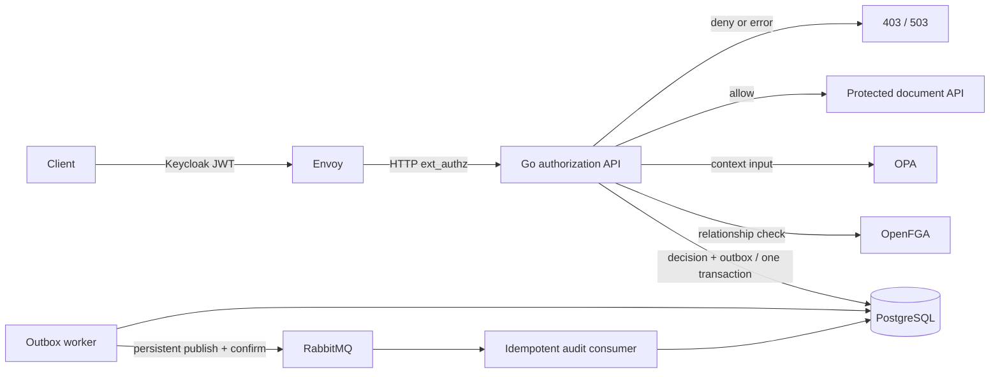

# Go Authorization Platform

A compact reference implementation of a multi-tenant authorization boundary in Go. It combines relationship data from OpenFGA with contextual rules from OPA, persists every evaluated decision and an outbox event in one PostgreSQL transaction, and delivers audit events through RabbitMQ to an idempotent consumer.

The repository is intentionally a single demonstrable system, not a reusable IAM product. The domain is limited to organizations, teams, folders, and documents so that the security properties remain inspectable.

## Request path



Envoy sends the original bearer token to the authorization API. The API validates issuer, signature, lifetime, and audience against Keycloak. Subject, tenant, roles, principal type, and MFA state are derived from validated claims; caller-supplied identity headers are not trusted. The demo's device, risk, and purpose headers simulate trusted edge context and are called out as a deployment boundary below.

OpenFGA answers *whether the principal has the requested relationship*. Its model demonstrates organization roles, team membership, usersets, folder inheritance, direct grants, and service principals. OPA answers *whether the current context permits use of that relationship*. Its policy enforces tenant equality, suspension, risk, MFA for destructive actions, and device/purpose requirements for restricted documents.

The final rule is explicit and fail-closed:

```text
allow = openfga_allowed AND opa_allowed AND audit_transaction_committed
```

An OpenFGA or OPA error returns `503` and never reaches the protected API. With `AUTHZ_AUDIT_REQUIRED=true`—the Compose default—a database failure also converts a prospective allow into a denial.

## Run the complete demo

Requirements: Docker with Compose, `make`, `curl`, and `jq`. The checked-in local passwords and client secret are deliberately scoped to loopback-only development services; do not reuse them.

```bash
make up
make demo
```

`make up` builds the Go binaries and starts PostgreSQL, OpenFGA, OPA, Keycloak, Envoy, RabbitMQ, the authorization API, the protected API, the outbox worker, the audit consumer, and OpenTelemetry Collector. OpenFGA's model and tuples and Keycloak's realm are bootstrapped automatically. `make observability-up` adds Prometheus and Grafana.

`make demo` obtains real Keycloak access tokens and sends real requests through Envoy. It verifies:

- an organization administrator can read the Acme roadmap;
- a same-tenant user without a relationship is denied;
- an inherited relationship is constrained by restricted-document context;
- trusted device plus purpose permits the contextual case;
- an Acme principal cannot read a Globex document;
- a destructive action without token-derived MFA is denied;
- a client-credentials service principal can use its narrow OpenFGA grant;
- every decision reaches PostgreSQL, the outbox is publisher-confirmed, and the SQL-idempotent consumer records it.

Useful local endpoints:

| Endpoint | Purpose |
|---|---|
| `http://localhost:10000` | Envoy-protected document API |
| `http://localhost:8085` | authorization API; bearer token required for decisions |
| `http://localhost:8081` | OpenFGA API |
| `http://localhost:8181` | OPA API |
| `http://localhost:8082` | Keycloak |
| `http://localhost:15672` | RabbitMQ management |
| `http://localhost:9090` | Prometheus |
| `http://localhost:3001` | Grafana |

All published ports bind to `127.0.0.1`. Stop containers with `make down`; use `make reset` to also remove this project's development volumes.

## Authorization model

Representative paths in [model.fga](policies/openfga/model.fga):

```text
organization admin -> document can_view/can_edit/can_delete
team#member -> folder viewer -> document parent -> document can_view
folder editor -> document parent -> document can_edit
service viewer -> document can_view
```

Objects include the tenant in their identifier (`document:acme/roadmap`) and also link to their organization. This prevents ambiguous IDs and makes tenant-crossing relationships visible in the graph. OPA independently compares subject and canonical resource tenants. Resource tenant and classification come from the demo resource catalog in the authorization service, not request headers.

The direct decision endpoint exists for integration with a trusted policy-enforcement point. It authenticates the caller and replaces supplied resource metadata with canonical demo metadata. The Envoy path is the primary demonstration because a denied request is rejected before the protected handler runs.

See [Authorization model](docs/authorization-model.md) and [ADR 0001](docs/adr/0001-openfga-plus-opa.md).

## Audit delivery

`SQLRepository.RecordDecision` inserts `authorization_decisions` and `outbox_events` under one transaction. Workers claim rows with `FOR UPDATE SKIP LOCKED`, use bounded concurrency, retry with capped exponential backoff, and reclaim stale publishing leases. RabbitMQ publishes are persistent, mandatory, and awaited with publisher confirms before an outbox row becomes `published`.

The consumer uses manual acknowledgements and a durable queue. A SQL inbox provides event leases and completed-event deduplication. Its demonstration handler performs an idempotent insert keyed by event ID. This gives at-least-once delivery without presenting it as exactly-once messaging.

See [ADR 0004](docs/adr/0004-transactional-outbox.md) and [Failure modes](docs/failure-modes.md).

## Development and validation

```bash
make check              # format check, vet, tests, race tests, builds
make policy-test        # OPA tests in the pinned container
make model-test         # OpenFGA model assertions in the pinned CLI
make compose-validate
make fail-closed-smoke  # live 401 and OPA-outage 503 checks; restores OPA
make helm-lint          # requires Helm
make bench              # in-process decision orchestration benchmark only
make load               # small k6 profile; obtains a local demo token when TOKEN is unset
```

CI runs module verification, formatting, vet, unit/integration and race tests, command builds, policy/model tests, Compose validation, container builds, Helm rendering, Terraform formatting/validation, CodeQL, dependency review, and `govulncheck`.

The in-process benchmark excludes network, database, policy-engine, and broker latency. It is useful for allocation/regression checks only. The k6 scenario exercises HTTP but is not a production capacity claim.

## Observability

The API exports low-cardinality counters for allow, deny, evaluation errors, and audit outcomes plus histograms for total, OpenFGA, and OPA latency. HTTP instrumentation emits W3C trace context through OpenTelemetry. Prometheus rules cover service availability, decision errors, audit persistence failures, and denial changes. Grafana provisions a small overview dashboard.

Decision and request IDs are returned as headers and fields. Tokens and full credential-bearing configuration are never logged.

## Deployment examples

The Helm chart demonstrates probes, resources, non-root/read-only containers, OPA as a sidecar, secret references, a PodDisruptionBudget, an HPA, NetworkPolicy, and an optional ServiceMonitor. These are examples: PostgreSQL, OpenFGA, Keycloak, RabbitMQ, and secret delivery remain platform dependencies.

- Helm: [`deploy/helm/go-authorization-platform`](deploy/helm/go-authorization-platform)
- Argo CD: [`deploy/argocd/application.yaml`](deploy/argocd/application.yaml)
- Terraform/Terragrunt: [`infrastructure`](infrastructure)
- CRD and webhook: [`deploy/kubernetes`](deploy/kubernetes)

`AuthorizationPolicyBinding` describes the intended policy and enforcement mode. The validating webhook rejects workloads marked `authz.platform.io/protected=true` unless they also reference a policy and include the `authorization-sidecar` container. It deliberately does not include a controller or sidecar injector.

`./scripts/generate-webhook-certs.sh` creates a 30-day local certificate, TLS Secret manifest, and webhook configuration with the CA bundle rendered under ignored `.local/` storage. Certificate rotation and trust delivery are platform responsibilities.

## Security boundaries and limitations

- TLS/mTLS, external secret management, Keycloak hardening, and network identity are deployment responsibilities. Compose is loopback-only development configuration.
- Device trust, risk, and purpose are simulated request context in the local demo. A real edge must derive or attest them and strip incoming copies before forwarding.
- The resource catalog is static and deliberately tiny. A real application would resolve immutable tenant/classification metadata from its resource service or database.
- Keycloak client credentials demonstrate service identity. Automated RFC 8693 token exchange is documented but left out because current Keycloak exchange permissions and deployment policy are environment-specific.
- The outbox provides at-least-once delivery. Consumers must remain idempotent; a broker acknowledgement can still be lost after successful handling.
- Readiness checks PostgreSQL. Startup verifies OpenFGA store/model discovery; authorization requests fail closed if OpenFGA, OPA, or JWKS access later fails.
- The Kubernetes, Argo CD, Terraform, and Terragrunt material is not a complete cluster or cloud platform and does not provision remote resources by itself.

See [Threat model](docs/threat-model.md), [Token delegation](docs/token-delegation.md), and the [degradation runbook](docs/runbooks/authorization-degradation.md).

## Repository layout

```text
cmd/                 API, outbox worker, audit consumer, demo API, webhook
internal/            authorization, authentication, audit, broker, HTTP, telemetry
policies/            OpenFGA model/tuples/tests and OPA policy/tests
migrations/          decision, outbox, inbox, and consumed-event schema
demo/                Keycloak realm and Envoy configuration
observability/       collector, Prometheus, alerts, and Grafana dashboard
deploy/              Helm, Kubernetes/CRD/webhook, and Argo CD examples
infrastructure/      Terraform module/environment and Terragrunt example
tests/               integration and k6 scenarios
docs/                ADRs, threat/failure analysis, testing notes, and runbooks
```

Apache-2.0 licensed. See [CONTRIBUTING.md](CONTRIBUTING.md) and [SECURITY.md](SECURITY.md).
