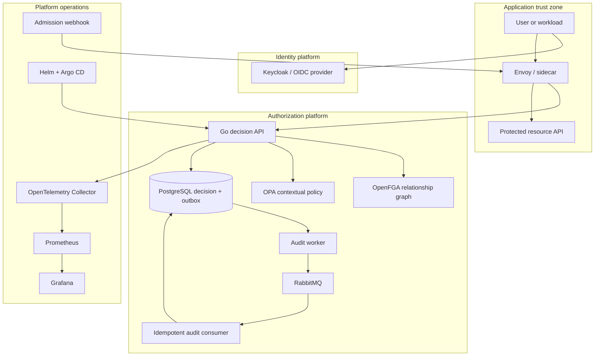
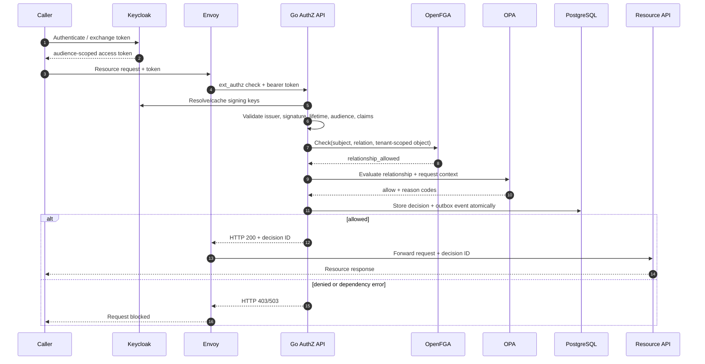

# Architecture

## Goal

Provide one understandable authorization platform that demonstrates security, platform, and operations engineering without creating an artificial fleet of microservices.

The project therefore uses a **modular Go service**, one audit worker, one audit consumer, and one protected demo workload. Each boundary should be separated later only when scaling, ownership, or isolation evidence justifies it.

## System context

## Decision sequence

## Component responsibilities

### Go authorization API

- validates and normalizes the request;
- resolves a relation (`view` → `can_view` by default);
- performs a tenant-scoped OpenFGA check;
- sends both request context and relationship result to OPA;
- combines results with deny-by-default semantics;
- emits a stable decision ID and reason codes;
- records the decision through an audit boundary;
- exposes direct and Envoy-compatible HTTP contracts.

It does **not** own passwords, issue identity tokens, or duplicate the OpenFGA graph in SQL.

### OpenFGA

Owns durable relationships and graph inheritance:

- organization roles;
- team membership;
- folder/document hierarchy;
- direct user and service-principal grants.

Resource object IDs include the tenant (`document:acme/roadmap`) to reduce accidental cross-tenant collisions. OPA still checks tenant equality as defense in depth.

### OPA

Owns request-time constraints:

- relationship result must be true;
- subject and resource tenants must match;
- suspended accounts are denied;
- risk above the threshold is denied;
- delete/manage requires MFA;
- restricted resources require trusted devices and an access purpose.

The policy remains small enough to audit. Complex organization structure stays in OpenFGA rather than being reproduced as Rego data.

### PostgreSQL, outbox worker, and audit consumer

The SQL repository writes the decision and outbox event in one transaction. The worker claims records using `FOR UPDATE SKIP LOCKED`, publishes with bounded concurrency and publisher confirms, and records retry state. The consumer uses manual acknowledgements plus a SQL inbox and idempotent event insert. This avoids a distributed transaction between PostgreSQL and RabbitMQ while making at-least-once delivery explicit.

### Envoy enforcement

The HTTP `ext_authz` filter blocks the application request until the decision service returns. `failure_mode_allow` is false. The decision ID is added to the upstream request for correlation.

The authorization API validates the bearer token itself and derives identity context from claims. The demo never accepts subject, role, tenant, or MFA headers from the client. Device, risk, and purpose headers simulate values that a production enforcement point must derive or attest after stripping incoming copies.

### Kubernetes admission webhook

A protected Pod, Deployment, StatefulSet, or DaemonSet is rejected unless its pod template contains:

- `authz.platform.io/protected: "true"`;
- a non-empty `authz.platform.io/policy-ref` annotation;
- an `authorization-sidecar` container.

The `AuthorizationPolicyBinding` CRD defines the intended policy binding. A reconciliation controller and sidecar injection are intentionally outside scope; the webhook itself is implemented and tested.

## Availability and scaling model

The API is stateless except for external dependencies and can scale horizontally. Suggested production starting point:

- two or more API replicas across zones;
- short dependency timeouts and bounded HTTP connection pools;
- OPA as an in-pod sidecar when very low policy latency and independent policy rollout are needed;
- replicated OpenFGA and PostgreSQL according to their operational guidance;
- outbox workers scaled independently with row locking;
- pod disruption budget, readiness probes, HPA, and topology spread constraints.

These are design targets, not claims that the project has been load-certified for a particular throughput.

## Security boundaries

1. **External → edge:** tokens are untrusted input until validated.
2. **Edge → authorization API:** the bearer token is revalidated; contextual headers require a private authenticated hop and edge sanitization.
3. **Authorization API → policy engines:** model/store IDs and policy paths are controlled configuration.
4. **Authorization API → audit database:** write path contains sensitive decision context and needs least privilege.
5. **GitOps → cluster:** policy/config promotion requires review and immutable revisions.
6. **Admission webhook → Kubernetes API:** TLS and `failurePolicy: Fail` protect enforcement.

## Non-goals

- building a general-purpose identity provider;
- replacing OpenFGA or OPA with a custom policy language;
- reproducing a full service mesh;
- creating a cloud account, cluster, or managed database from this repository;
- claiming multi-region consistency without measured evidence;
- turning every package into a separately deployed service.
