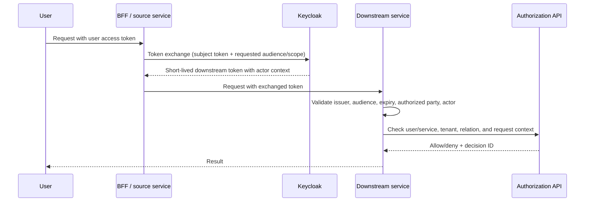

# Token exchange and delegation

## Goal

Allow a service to perform a narrowly scoped operation on behalf of a user without forwarding a broad user token through every hop.

## Proposed flow

## Claims to validate

- `iss`: expected realm/issuer;
- `aud`: exact downstream audience;
- `exp`, `nbf`, `iat`: accepted time window;
- `sub`: effective subject;
- `azp`: authorized party/client;
- `act`: actor chain when the token represents delegated execution;
- `tenant_id`: tenant context;
- scopes/roles: only those required by the downstream operation.

The OIDC adapter in `internal/authn` validates issuer and audience and extracts tenant, realm roles, `azp`, and `act`. Production wiring should also validate allowed actor/client combinations and reject actor-chain depth beyond the agreed limit.

## Downscoping rules

1. The exchanged token has one downstream audience.
2. Lifetime is shorter than the original user token.
3. Requested scopes are an intersection, never an expansion.
4. Tenant context cannot be changed during exchange.
5. High-risk actions still require current MFA or a step-up claim.
6. The authorization decision records both effective subject and actor.
7. A service token without user delegation is modeled as `service:<id>` in OpenFGA.

## Confused-deputy controls

- downstream services reject tokens minted for another audience;
- token exchange is permitted only for registered source→target client pairs;
- user-controlled headers cannot override `sub`, `act`, or `tenant_id`;
- the resource tenant is derived from the resource lookup, not only from the token;
- the authorization API compares both tenants;
- audit records include actor, subject, audience, and decision correlation IDs.

## Local Keycloak baseline

`demo/keycloak/realm-export.json` provides:

- `demo-cli`, a local public client;
- `authz-api`, a bearer-only audience boundary;
- `reporting-service`, a workload client;
- users and tenant claims for the local demo.

It does not configure RFC 8693 exchange permissions. Those permissions are deployment-specific; an implementation must configure an explicit source/target pair, verify actor and audience claims, and test both valid and invalid delegation. The local demo instead proves a narrow client-credentials service identity.

## Delegation test cases

- valid user → reporting-service exchange;
- wrong target audience;
- actor client not permitted for target;
- tenant claim changed or missing;
- expired or not-yet-valid token;
- delegated delete without MFA;
- service acting without user delegation;
- replay of the same event-side effect, protected by inbox idempotency.
